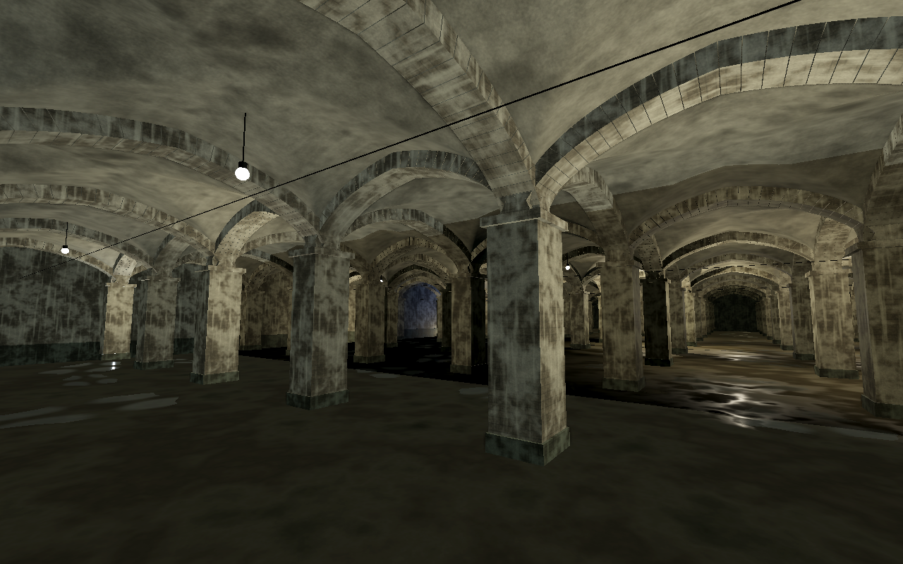

# Cisterne-kortet

Kortet er bygget oven på den eksisterende baseplate i `Cisterne.tscn` med
udgangspunkt i referencebilledernes søjler, let spidse buer, krydshvælvinger,
kalkpletter og fugtige gulve.

Baseplaten er stadig den oprindelige `MeshInstance3D` med samme BoxMesh,
placering og tykkelse. Den er gjort **15 % større vandret: 60 × 30 → 69 × 34,5**.
Dens aflange form og forholdet 2:1 er bevaret. Kortets længderetning følger
baseplatens X-akse, og bygningen holder sig inden for dens kanter.

## Åbn og redigér

1. Hent ændringerne med **Pull** i VS Code.
2. Åbn **`Cisterne.tscn`** i Godot, og vælg **3D**.
3. Fold **CisterneMap** ud i scenetræet. Noderne er gjort redigerbare.
4. Vælg en søjle eller bue og tryk **F** for at fokusere på den.
5. Hold højre museknap nede i 3D-visningen og brug **WASD** for at udforske kortet.
6. Gem med **Ctrl+S**. **F5** viser kortet fra det gemte forhåndsvisningskamera.

F5 er en statisk forhåndsvisning. Kortet har ingen spillerstyring eller scripts.

| Node | Hvad den indeholder |
| --- | --- |
| MeshInstance3D | Din baseplate, gulvmaterialet og den tilføjede gulvkollision |
| CisterneMap/Architecture/Pillars | 104 søjler i 13 rækker; syv gennemgående gange |
| CisterneMap/Architecture/Arches | 187 tværgående og langsgående buer |
| CisterneMap/Architecture/Vaults | 84 krydshvælvinger med gemte kollisionsformer |
| CisterneMap/Architecture/Walls | Ydervægge og mørke, fugtige sokler |
| CisterneMap/Puddles | Uregelmæssige, bløde vandpytter med almindelige Godot-materialer |
| CisterneMap/Lighting | WorldEnvironment, refleksionsprober, pendellamper og lyspunkter |
| CisterneMap/Details | Ophængswirer og små vægarmaturer |
| CisterneMap/PreviewCameras | Kamera langs midtergangen og et kamera på skrå gennem hvælvingerne |
| CisterneMap/FuturePlayerSpawn | En redigerbar markør til en senere spiller |

Flyt en genstands forældrenode for at holde grafik og kollision sammen.
Hvis du ændrer en BoxMesh-størrelse, skal den tilsvarende CollisionShape3D
også tilpasses. Bevar kortets placering i forhold til baseplaten, hvis du
flytter dem hver for sig.

## Materialer og byggeklodser

Grundscenerne ligger i `cistern/`: `Pillar.tscn`, `CrossArch.tscn`,
`SideArch.tscn`, `GroinVault.tscn` og `HangingLamp.tscn`. Hele kortet ligger i
`cistern/CisternMap.tscn`. Åbn en grundscene for at ændre alle dens instanser,
eller redigér en enkelt instans fra hovedscenen.

Materialerne i `cistern/materials/` er almindelige **StandardMaterial3D**-
ressourcer. Farve, ruhed, normaler, gennemsigtighed og teksturskala kan ændres
i Inspector. Brug **Make Unique**, hvis en materialeændring kun skal gælde
én genstand. Teksturerne og de gemte buede mesh er lavet til dette kort.

Alt indhold er **gemte, redigerbare noder og ressourcer**. Der er ingen
GDScript-, shader- eller opstartsscripts i kortet. Denne præference er også
skrevet i `AGENTS.md`, så den følger fremtidigt arbejde i projektet.

Projektets eksisterende Godot 4.7-/Forward+- og Windows-driverindstillinger
er bevaret. Skærmrefleksioner og SSAO bruger Forward+; forhåndsvisning i
Compatibility ser derfor anderledes ud. Kortet er kontrolleret i Godot 4.6.3
med headless validering og software-OpenGL. Kontrollér den endelige Forward+-
belysning på din egen PC.
